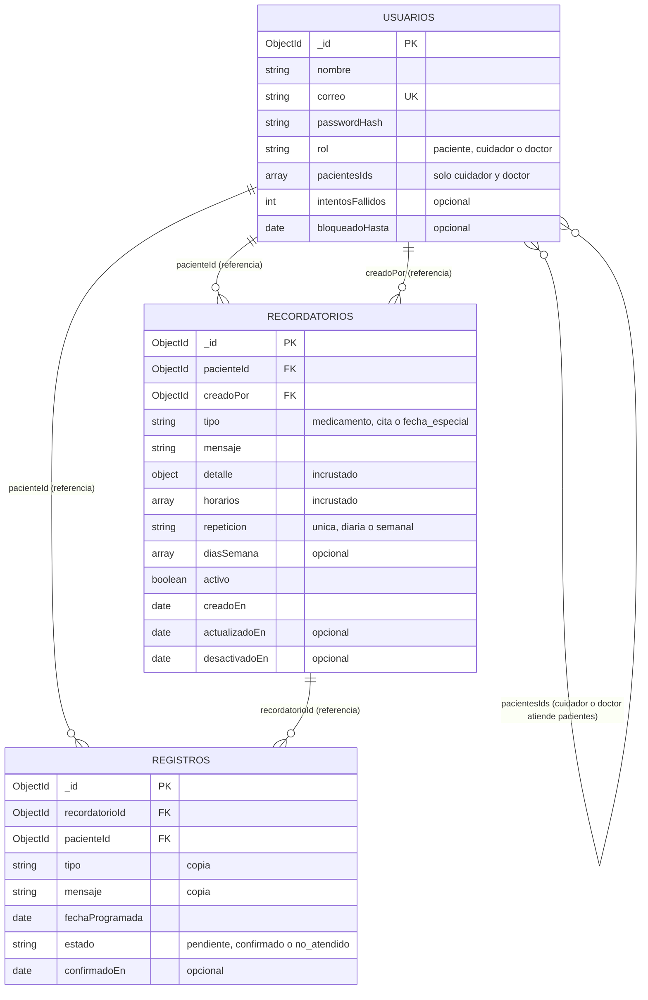

# Modelo final de la base de datos

Base de datos `recuerdame` en MongoDB Atlas, con tres colecciones. Este documento reemplaza al modelo versión 2 de `docs/semana3/modelo-v2.md`.

## Diagrama

## Diccionario de campos

### usuarios

| Campo | Tipo | Obligatorio | Descripción |
|---|---|---|---|
| `_id` | ObjectId | Sí | Identificador |
| `nombre` | string | Sí | Nombre de la persona |
| `correo` | string | Sí | Correo en minúsculas, único. Se usa para iniciar sesión |
| `passwordHash` | string | Sí | Contraseña cifrada con bcrypt. Nunca se guarda en texto plano |
| `rol` | string | Sí | `paciente`, `cuidador` o `doctor` |
| `pacientesIds` | array de ObjectId | Solo cuidador y doctor | Pacientes que atiende |
| `intentosFallidos` | entero | No | Contador de inicios de sesión fallidos seguidos |
| `bloqueadoHasta` | fecha | No | Si existe y es futura, la cuenta está bloqueada |

### recordatorios

| Campo | Tipo | Obligatorio | Descripción |
|---|---|---|---|
| `_id` | ObjectId | Sí | Identificador |
| `pacienteId` | ObjectId | Sí | Paciente al que pertenece |
| `creadoPor` | ObjectId | Sí | Cuidador o doctor que lo creó |
| `tipo` | string | Sí | `medicamento`, `cita` o `fecha_especial` |
| `mensaje` | string | Sí | Texto que se dice en voz alta (mínimo 5 caracteres) |
| `detalle` | objeto | No | Datos propios del tipo. Medicamento: `nombre`, `dosis`. Cita: `lugar`, `profesional`. Fecha especial: `persona` |
| `horarios` | array de string | Sí | Horas en formato `HH:MM` (al menos una) |
| `repeticion` | string | Sí | `unica`, `diaria` o `semanal` |
| `diasSemana` | array de entero | No | Días de 0 a 6, solo si es semanal |
| `activo` | booleano | Sí | `false` significa baja lógica |
| `creadoEn` | fecha | Sí | Fecha de creación |
| `actualizadoEn` | fecha | No | Última edición |
| `desactivadoEn` | fecha | No | Fecha de la baja lógica |

### registros

| Campo | Tipo | Obligatorio | Descripción |
|---|---|---|---|
| `_id` | ObjectId | Sí | Identificador |
| `recordatorioId` | ObjectId | Sí | Recordatorio al que corresponde |
| `pacienteId` | ObjectId | Sí | Paciente |
| `tipo` | string | Sí | Copia del tipo del recordatorio |
| `mensaje` | string | Sí | Copia del mensaje del recordatorio |
| `fechaProgramada` | fecha | Sí | Momento en que debía sonar el aviso |
| `estado` | string | Sí | `pendiente`, `confirmado` o `no_atendido` |
| `confirmadoEn` | fecha | No | Cuándo confirmó el paciente |

## Decisiones de modelado

- **Se incrustan** `detalle` y `horarios` dentro del recordatorio: siempre se leen junto con él, son pocos datos y no se consultan por separado. `detalle` además cambia de forma según el tipo, que es la razón principal para usar MongoDB.
- **Se referencian** los `registros` en una colección aparte: se genera uno por cada aviso y cada día, así que dentro del recordatorio crecerían sin límite.
- **`pacientesIds` es un arreglo de referencias** dentro del usuario: la cantidad de pacientes por cuidador o doctor es pequeña y acotada, y permite saber en una sola lectura qué pacientes puede ver.
- **Duplicación consciente:** `tipo` y `mensaje` se copian en `registros` para que el historial muestre lo que se dijo en ese momento, aunque el recordatorio se edite después.
- **Baja lógica:** un recordatorio se desactiva (`activo: false`) en lugar de borrarse, para no dejar registros huérfanos.
- **Confirmación idempotente:** confirmar el mismo aviso dos veces no duplica el registro, porque se usa una actualización con `upsert` sobre `recordatorioId` y `fechaProgramada`.
- **Validación en la base de datos** (`$jsonSchema`) en `recordatorios` y `registros`, además de la validación de la API.

## Índices

| Índice | Colección | Para qué |
|---|---|---|
| `correo_1` (único) | `usuarios` | Evitar cuentas duplicadas y buscar rápido al iniciar sesión |
| `idx_recordatorios_paciente_activo_fecha` | `recordatorios` | Lista de recordatorios activos de un paciente, ordenada por fecha |
| `idx_registros_paciente_fecha` | `registros` | Historial, avisos de hoy y las dos agregaciones |

## Cambios respecto al modelo versión 2

| Cambio | Motivo |
|---|---|
| Nuevo valor `doctor` en `rol` y `pacientesIds` también para doctores | Tercer tipo de usuario |
| Campos `intentosFallidos` y `bloqueadoHasta` en `usuarios` | Bloqueo temporal de la cuenta tras 5 contraseñas incorrectas |
| Campos `actualizadoEn` y `desactivadoEn` en `recordatorios` | Auditar ediciones y bajas lógicas |
| Índices `idx_recordatorios_paciente_activo_fecha` e `idx_registros_paciente_fecha` | Consultas reales de la aplicación y de las agregaciones |

## Límites del modelo

- Los recordatorios de una sola vez no tienen fecha, por lo que al paciente le aparecen hasta que los confirma. Agregar un campo `fecha` es la mejora natural.
- La consistencia entre colecciones (por ejemplo, que `pacienteId` exista en `usuarios`) la garantiza la aplicación, no la base de datos, que no tiene claves foráneas.
- Las agregaciones usan la zona horaria `America/Santiago` fija en el código.
